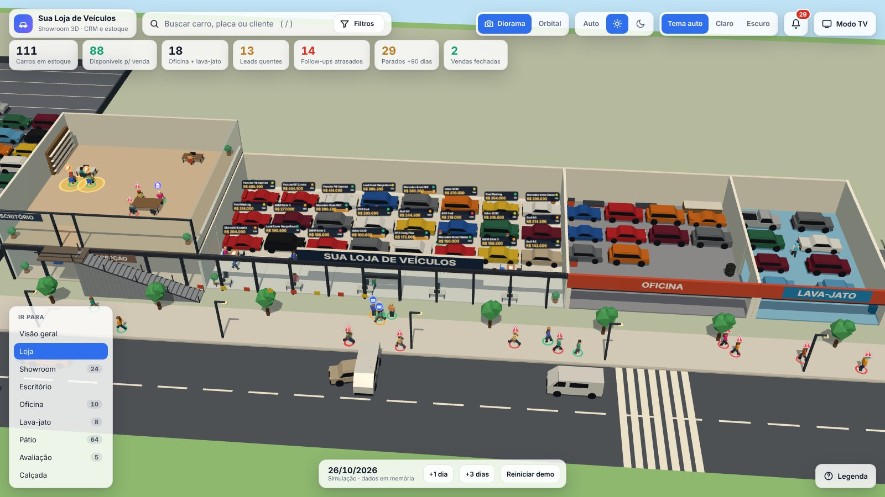
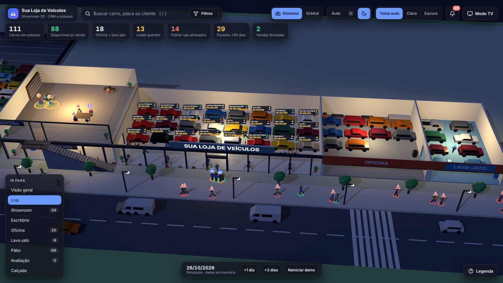
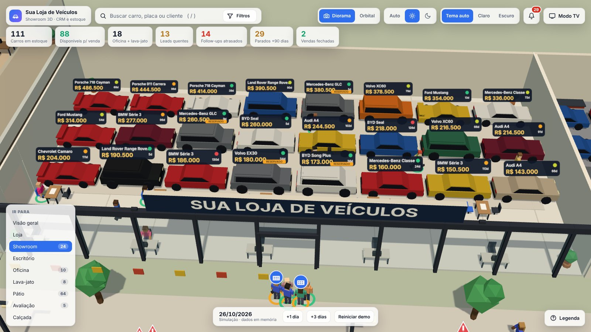
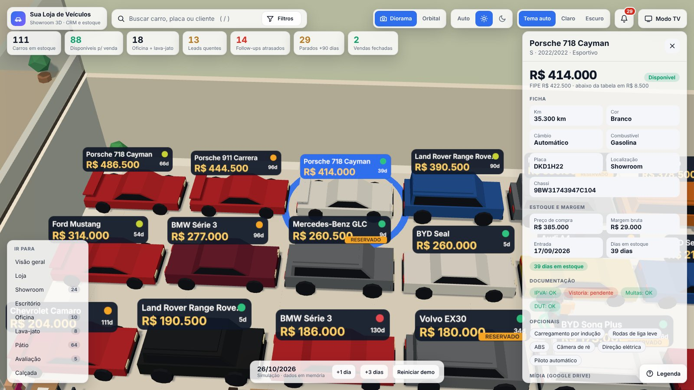
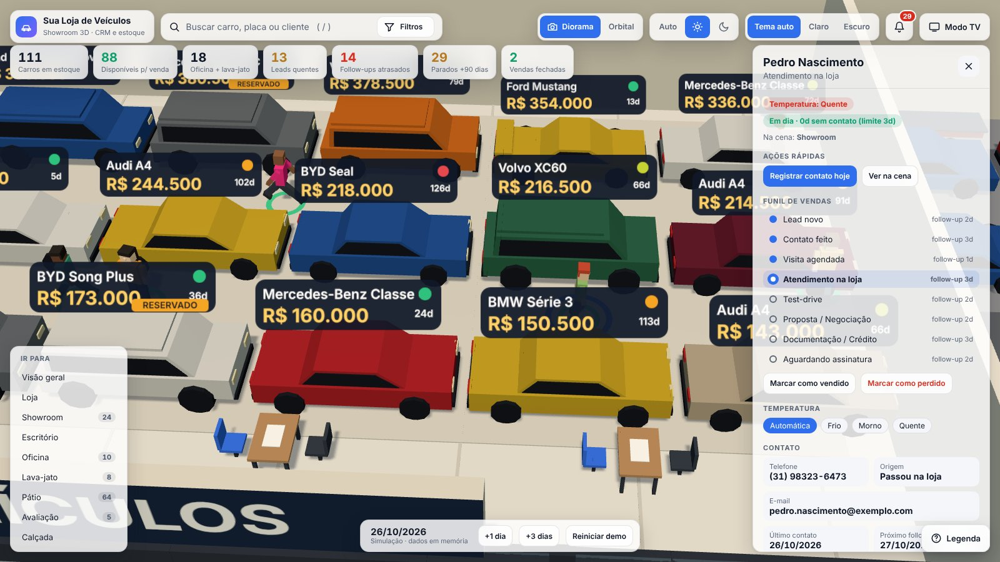
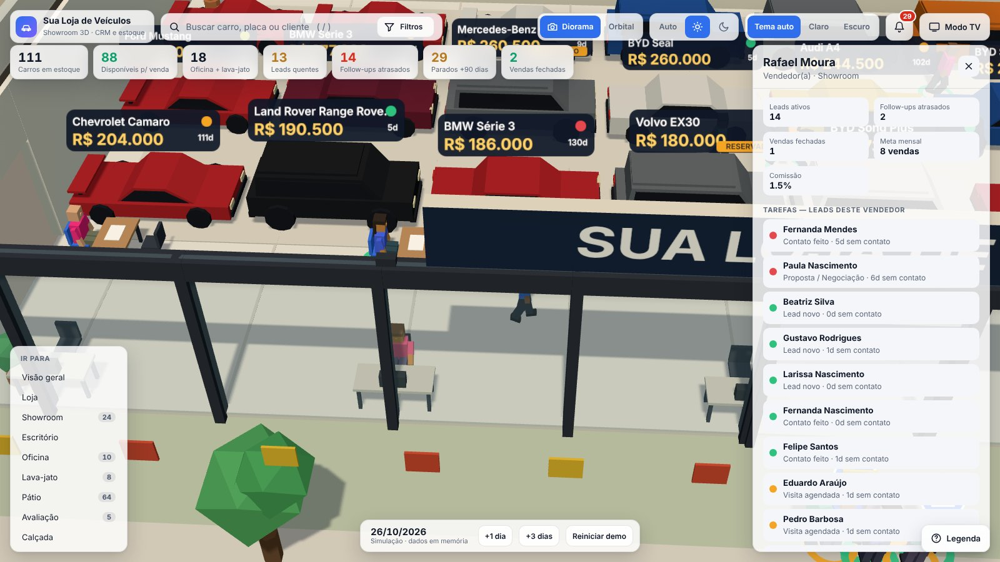
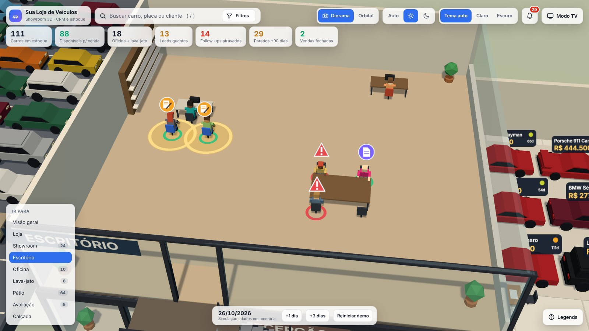
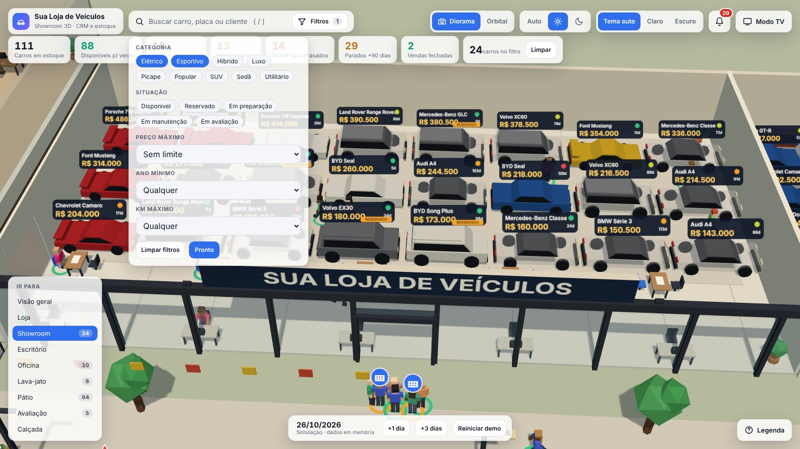
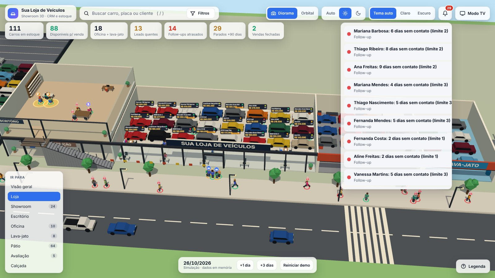
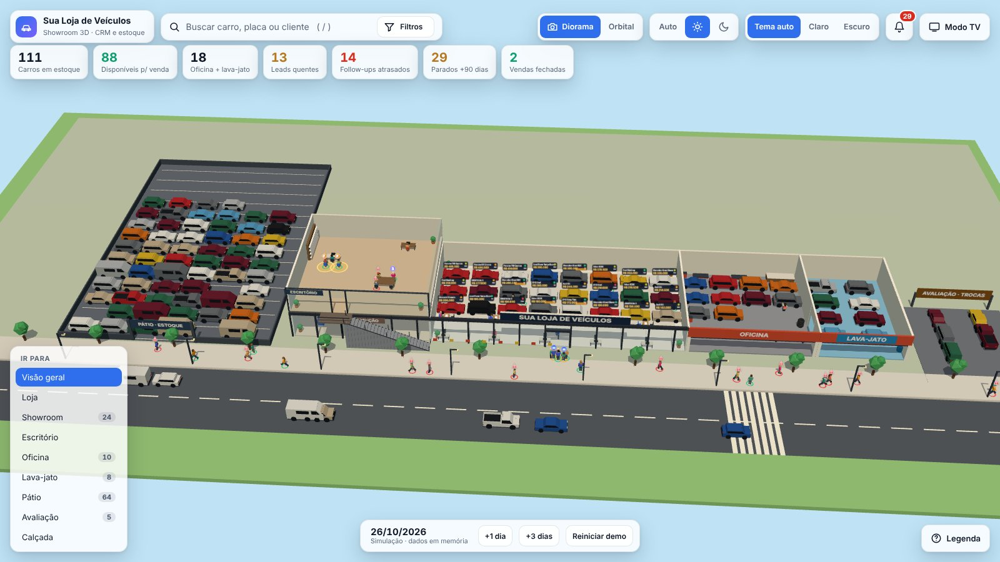

# CRM Showroom Carros

**Veja a sua loja inteira de uma vez: cada carro no lugar, cada cliente na etapa certa.** Um showroom 3D que é, ao mesmo tempo, o CRM de vendas e o controle de estoque da revenda. Quem precisa de atenção salta aos olhos: o cliente sem retorno volta para a calçada, o carro parado há meses acende em vermelho.

> Status: **Fase 2 (animação 3D) concluída; Fase 3 (CRM real com Google Sheets) planejada.** Nesta etapa os dados são de exemplo (120 carros, 40 leads, 9 funcionários) e ficam só em memória. Planejamento completo em [`docs/roadmap.md`](docs/roadmap.md).



### Por que usar

- **O funil vira cena:** lead novo espera na calçada, atendimento acontece no showroom, negociação na mesa, assinatura no escritório. Dá para ver a situação das vendas num relance.
- **Ninguém fica sem retorno:** cada etapa tem prazo de follow-up; quem passa do prazo ganha um alerta vermelho e volta para a calçada.
- **Estoque com preço e margem:** cada carro mostra preço, dias em estoque, margem sobre a compra, FIPE, documentação e opcionais.
- **Arraste para atualizar:** levar um carro do pátio para a oficina ou o lava-jato muda a situação dele no estoque.
- **Indicadores no topo:** carros disponíveis, leads quentes, follow-ups atrasados, carros parados há mais de 90 dias e vendas fechadas.
- **Modo TV e modo noite:** passeio automático pelos ambientes para um monitor da loja, com dia e noite conforme o horário.

### Telas

| | |
|---|---|
|  |  |
| **Modo noite:** a cena acompanha o horário e o tema escurece junto. | **Showroom:** preço, dias em estoque e situação em cada carro. |
|  |  |
| **Ficha do carro:** preço x FIPE, margem bruta, documentação e opcionais. | **Ficha do cliente:** temperatura, prazo do retorno e funil clicável. |
|  |  |
| **Vendedor:** carteira de leads, meta do mês, comissão e quem está atrasado. | **Escritório:** documentação, crédito e assinatura (com brilho dourado). |
|  |  |
| **Busca e filtros:** o que não combina fica apagado na cena. | **Alertas:** todos os retornos atrasados, com um clique para abrir o cliente. |
|  | |
| **Visão geral:** pátio, loja, oficina, lava-jato e avaliação de trocas. | |

*Prints feitos com os dados de exemplo (nomes, telefones e e-mails fictícios). Para refazer depois de mudar o visual: `npm run demo && npm run prints`.*

## Como abrir

**Mais simples (sem instalar nada):** baixe `demo/showroom3d.html` e dê duplo clique (é o app inteiro em um arquivo só; use Chrome, Edge ou Firefox).

**Para desenvolver** (precisa do [Node.js](https://nodejs.org) 20+):

```bash
npm install        # uma vez
npm run dev        # abre em http://localhost:5173 com recarga automática
npm run build      # gera dist/index.html (arquivo único)
npm run demo       # faz o build e atualiza demo/showroom3d.html
npm test           # 21 testes das regras do funil, layout e filtros
npm run dados      # regenera src/dados/dados-exemplo.json
npm run prints     # refaz os prints do README (precisa do Playwright, veja scripts/prints.mjs)
```

## Como usar a demo

| Ação | O que acontece |
|---|---|
| Clicar em um **carro** | Abre a ficha (preço, ano, km, margem, documentos, links do Drive) |
| **Arrastar um carro** até outra zona | Muda a situação dele (showroom, pátio, oficina, lava-jato, avaliação) |
| Clicar em um **cliente** | Ficha do lead, funil clicável, registrar contato, ajustar temperatura |
| Clicar em um **vendedor** | Leads dele + botão para destacar os clientes na cena |
| Clicar em uma **zona** (chão) | Lista dos carros daquela zona |
| **+1 dia / +3 dias** | Simula o tempo: clientes sem follow-up voltam para a calçada |
| Busca (`/`) e **Filtros** | Carros que não combinam ficam apagados na cena |
| **Modo TV** | Só a cena, trocando de ambiente sozinha (Esc sai) |

Regras da cena: lead novo ou sem follow-up fica na **calçada**; contato feito na **porta**; atendimento no **showroom**; negociação na **mesa**; documentação e assinatura no **escritório** (assinatura com brilho dourado); venda fechada tem confete e o carro sai da loja.

## Estrutura

```
src/regras/   regras do negócio puras (funil, follow-up, zonas) — testadas
src/dados/    DataSource (JsonSource agora; Google Sheets na Fase 3) + dados de exemplo
src/cena/     Three.js: cenário, carros, pessoas, comportamentos, câmeras, dia/noite
src/ui/       painéis, busca/filtros, HUD, interação com o 3D, temas
tests/        testes automáticos (node --test)
docs/         roadmap.md (planejamento e decisões), a skill de como construir este tipo de projeto e screenshots/
demo/         showroom3d.html — o app em um arquivo só (gerado por `npm run demo`)
.github/      integração contínua: roda testes e build a cada envio
```

Para mudar nome da loja, limites de follow-up por etapa ou capacidade do showroom, edite `config` em `scripts/gerar-dados.mjs` e rode `npm run dados`.

## Como evoluir o projeto

- O planejamento vive em `docs/roadmap.md` (decisões D01…, backlog e fases). Atualize-o a cada rodada.
- Antes de enviar mudanças: `npm test` e `npm run demo`.
- Mensagens de commit no padrão `tipo(área): o que mudou` (`feat`, `fix`, `docs`, `test`, `chore`, `ci`).
- **Nunca suba** credenciais do Google, planilhas com dados reais de clientes ou arquivos `.env` (o `.gitignore` já bloqueia os nomes mais comuns).
- `docs/skill-showroom-3d-crm.md` resume tudo que foi aprendido e serve de guia para projetos parecidos.

## Licença

Ainda não definida. Sem uma licença, o código continua com todos os direitos reservados ao autor.
